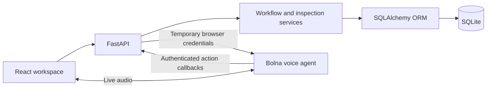

# Lattice

### Turning instructions into action.

Lattice is a workflow copilot for work that happens away from a desk. Supervisors turn procedures into clear inspection steps. Operators follow the guide, capture observations and measurements, correct answers and pick up where they left off. A complete inspection record brings the results together for human review.

## From procedure to record

1. **Build a workflow.** Paste a procedure, use the inspection example or write your own steps. Add starting information and configure measurement, observation, choice or confirmation responses.
2. **Set the rules.** Define acceptable measurement ranges. Choose whether an out-of-range response should be flagged for review or resolved before work continues.
3. **Publish a version.** Mark the workflow ready. Each inspection uses a fixed copy of that version so subsequent edits do not change work already underway.
4. **Run the inspection.** Enter responses on screen or start a Bolna voice conversation. Spoken answers are repeated for confirmation before recording.
5. **Keep the history.** Correct an answer without losing its earlier value. Pause, refresh the browser and resume with the same progress.
6. **Review and export.** Complete the inspection and download a JSON record containing the workflow version, answers, deviations, timestamps, correction history and session events.

Completion and approval are separate: a completed record awaits human review.

## Capabilities

- Visual workflow builder with autosaved drafts and numbered published versions
- Persistent inspections with required-response checks and controlled step progression
- Decimal measurement checks with flag-and-continue or resolve-before-continuing handling
- Bolna voice guidance with answer confirmation, corrections, navigation and pause commands
- Response provenance and append-only correction records
- Saved session recovery after refresh or application restart
- Workflow import from existing browser storage
- Portable JSON workflow and inspection exports

## Architecture



FastAPI is the authority for workflow validation, measurement checks and inspection progression. Manual input and Bolna tools use the same services. Bolna handles the voice conversation; the app makes no direct calls to other speech providers.

SQLite stores workflow drafts, published versions, session state, response revisions, session events and voice-run metadata. Foreign keys, WAL mode and bounded lock waits support the local workspace. Revision checks prevent stale edits from overwriting newer changes. Command IDs make repeated requests safe.

## Quick start

Requirements: **Python 3.12**, **uv** and **Node.js 22.13+** with npm.

### 1. Start the backend

From the project directory:

```powershell
cd backend
Copy-Item .env.example .env
uv sync --locked
uv run alembic upgrade head
uv run uvicorn app.main:app --host 127.0.0.1 --port 8000 --reload
```

The database lives in `backend/data/lattice.db`. Environment paths in the example assume commands run from `backend/`.

### 2. Start the frontend

Open another terminal:

```powershell
cd frontend
npm ci
npm run dev
```

Open the URL printed by Vite. Its `/api` proxy forwards requests to the local backend. The standard frontend URL is [localhost:5173](http://localhost:5173).

Create a workflow, publish it and start a session. Typed inspections use the local API and database independently of voice configuration.

### 3. Bring over saved workflows

Choose **Import browser workflows** in the workflow workspace. Import copies definitions saved by earlier versions of Lattice into SQLite. Existing server IDs are skipped and the original browser copy is retained.

## Environment configuration

Copy the example once and edit the local file. Keep credentials out of source control.

| Backend variable | Purpose |
| --- | --- |
| `DATABASE_URL` | Async SQLite connection URL |
| `CORS_ORIGINS` | JSON array of allowed frontend origins |
| `BOLNA_API_KEY` | Server-side Bolna account key |
| `BOLNA_AGENT_ID` | Dedicated Lattice agent, written by the setup command |
| `BOLNA_CALLBACK_SECRET` | Strong shared secret for agent-to-backend requests |
| `PUBLIC_CALLBACK_URL` | Public HTTPS origin forwarding to the callback service |
| `BOLNA_VOICE_ID` | Voice selection used when provisioning the agent |
| `BOLNA_TIMEOUT_SECONDS` | Provider request timeout |

The optional frontend `VITE_API_BASE_URL` overrides `/api/v1` for hosting arrangements without the Vite proxy. Never put a Bolna key in a `VITE_` variable.

## Bolna setup

1. Add a Bolna API key to `backend/.env`. Ensure browser web calls are enabled for the account.
2. Generate a strong random value for `BOLNA_CALLBACK_SECRET`, for example with `uv run python -c "import secrets; print(secrets.token_urlsafe(32))"`.
3. Start the callback-only application in a separate terminal:

   ```powershell
   cd backend
   uv run uvicorn app.main:callback_app --host 127.0.0.1 --port 8001
   ```

4. Forward a public HTTPS tunnel to port **8001**, for example `ngrok http 8001`. Set its HTTPS origin as `PUBLIC_CALLBACK_URL`. The callback application exposes only authenticated Bolna routes; keep the workspace API on port 8000 local.
5. Create the dedicated agent:

   ```powershell
   uv run python -m app.cli setup-bolna
   ```

6. Restart both backend processes after updating environment settings. In an active inspection, choose **Start voice** and grant microphone access.

Agent settings are defined in `backend/bolna/agent.json`; conversational instructions are in `backend/bolna/prompt.md`. Provider selections within that template are managed by Bolna. Agent provisioning does not run automatically at startup and does not place a call.

The browser receives temporary call credentials instead of the account API key. The agent fetches fresh inspection context, proposes captured answers and asks for spoken confirmation. Backend callbacks enforce response rules before an answer is recorded. Closing voice releases microphone access while preserving the inspection. Raw audio is not stored by the Lattice backend.

## Database migrations and backups

Apply migrations before starting a new installation or after pulling schema changes:

```powershell
cd backend
uv run alembic upgrade head
```

Generate a migration after changing ORM models with `uv run alembic revision --autogenerate -m "describe change"`, then review it before applying it. For backups, stop both backend processes before copying the SQLite database. Preserve the backup outside the repository. Database files and their WAL/journal companions are ignored by Git.
